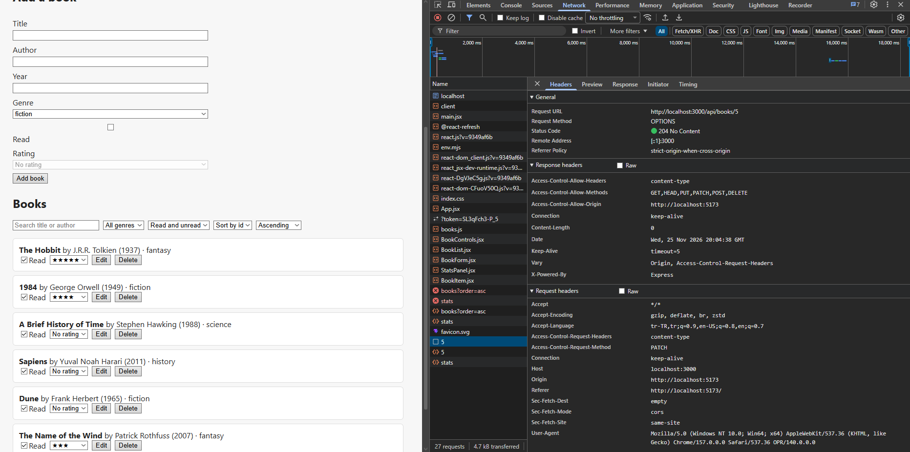

Requirements
Node.js (current LTS) and npm
Git Bash (or any Unix-like shell) for the commands below
Installation and running
Server
```bash
cd server
npm install
npm run dev # development, restarts on changes (node --watch)
npm start # normal start
```

The server runs on http://localhost:3000 by default.

Variable	Default	Meaning
PORT	3000	Port of the API
CLIENT_ORIGIN	http://localhost:5173	The only origin allowed by CORS
Example with other values (Git Bash): PORT=4000 CLIENT_ORIGIN=http://localhost:5173 npm run dev

Client
```bash
cd client
npm install
cp .env.example .env
npm run dev
```

The client runs on http://localhost:5173.
Variable: VITE_API_URL
Example: http://localhost:3000/api
Meaning: Base URL of the API, read with import.meta.env

If the server port changes, update VITE_API_URL in client/.env and restart Vite. No Vite proxy is used: the server sends the CORS headers itself with the cors package.

File organization:
/server
- server.js Express app: middleware, routes, 404 fallback, error handler
- booksStore.js In-memory data, async functions, immutable updates
- validate.js Hand-written validation for ids, books and query options
- package.json
- package-lock.json
/client
- books.js All fetch calls and the shared request helper
- BookControls.jsx Search, genre, read, sort and order controls
- BookList.jsx Loading, error and empty states
- BookItem.jsx One book: read toggle, rating, edit, delete
- BookForm.jsx Add form and edit form (PUT)
- StatsPanel.jsx Statistics from GET /api/stats
- App.jsx State, effects with AbortController, handlers
- main.jsx
- index.css
- .env.example
- index.html
- package.json
- .gitignore
- README.md

API overview:
Method and path - Success - Errors
GET /api/books	200	400
GET /api/books/:id	200	400, 404
POST /api/books	201 + Location	400, 409
PUT /api/books/:id	200	400, 404, 409
PATCH /api/books/:id	200	400, 404, 409
DELETE /api/books/:id	204	400, 404
GET /api/stats	200	—
GET /api/crash	—	500 (test route)

Query options for GET /api/books: genre, read, q, sort (title, author, year, rating), order (asc, desc), limit (1–50), page.
GET /api/crash is a test route that throws inside an async handler on purpose. It proves that Express 5 passes the error to the error-handling middleware, which logs it and answers 500 with { "error": "Something went wrong" }.

## Testing evidence (curl)

All requests were sent from Git Bash to the running server. Requests 1–14 were sent in one session starting from the seed data. Requests 15–19 were sent after restarting the server (seed data again), so the new book gets id 7.

### 1. 200 – list with several query parameters

```bash
curl --include "http://localhost:3000/api/books?genre=fiction&sort=year&order=desc"
```

```text
HTTP/1.1 200 OK
X-Powered-By: Express
Access-Control-Allow-Origin: http://localhost:5173
Vary: Origin
Content-Type: application/json; charset=utf-8
Content-Length: 209
ETag: W/"d1-oVKENv2c9tpMjKFv4Pdlqnz0H/M"
Date: Wed, 25 Nov 2026 19:41:40 GMT
Connection: keep-alive
Keep-Alive: timeout=5

[{"id":5,"title":"Dune","author":"Frank Herbert","year":1965,"genre":"fiction","read":false,"rating":null},{"id":2,"title":"1984","author":"George Orwell","year":1949,"genre":"fiction","read":true,"rating":4}]
```

Only fiction books are returned, sorted by year from newest to oldest.

### 2. 200 – one book

```bash
curl --include http://localhost:3000/api/books/1
```

```text
HTTP/1.1 200 OK
X-Powered-By: Express
Access-Control-Allow-Origin: http://localhost:5173
Vary: Origin
Content-Type: application/json; charset=utf-8
Content-Length: 108
ETag: W/"6c-wksYbf6e3ZJvQpjSjKuybvZ7BPQ"
Date: Wed, 25 Nov 2026 19:41:55 GMT
Connection: keep-alive
Keep-Alive: timeout=5

{"id":1,"title":"The Hobbit","author":"J.R.R. Tolkien","year":1937,"genre":"fantasy","read":true,"rating":5}
```

### 3. 200 – statistics before a change

```bash
curl --include http://localhost:3000/api/stats
```

```text
HTTP/1.1 200 OK
X-Powered-By: Express
Access-Control-Allow-Origin: http://localhost:5173
Vary: Origin
Content-Type: application/json; charset=utf-8
Content-Length: 109
ETag: W/"6d-wSNUq8K2XvZ7c7L+tNMDx9ojpS4"
Date: Wed, 25 Nov 2026 19:42:08 GMT
Connection: keep-alive
Keep-Alive: timeout=5

{"total":6,"read":4,"unread":2,"averageRating":4,"byGenre":{"fantasy":2,"fiction":2,"science":1,"history":1}}
```

### 4. 400 – invalid body

```bash
curl --include -X POST http://localhost:3000/api/books -H "Content-Type: application/json" -d '{"title":"Test","author":"Someone","year":3000,"genre":"fiction"}'
```

```text
HTTP/1.1 400 Bad Request
X-Powered-By: Express
Access-Control-Allow-Origin: http://localhost:5173
Vary: Origin
Content-Type: application/json; charset=utf-8
Content-Length: 61
ETag: W/"3d-R1HxlzjfCJHRlHTHeseOyO0rvCo"
Date: Wed, 25 Nov 2026 19:42:38 GMT
Connection: keep-alive
Keep-Alive: timeout=5

{"error":"\"year\" must be an integer between 1000 and 2026"}
```

### 5. 400 – repeated query parameter

```bash
curl --include "http://localhost:3000/api/books?genre=fiction&genre=history"
```

```text
HTTP/1.1 400 Bad Request
X-Powered-By: Express
Access-Control-Allow-Origin: http://localhost:5173
Vary: Origin
Content-Type: application/json; charset=utf-8
Content-Length: 58
ETag: W/"3a-6mT0mDMdSpAfOdjXJoHaV9ooo4w"
Date: Wed, 25 Nov 2026 19:42:52 GMT
Connection: keep-alive
Keep-Alive: timeout=5

{"error":"Query parameter \"genre\" must not be repeated"}
```

### 6. 404 – missing book

```bash
curl --include http://localhost:3000/api/books/999
```

```text
HTTP/1.1 404 Not Found
X-Powered-By: Express
Access-Control-Allow-Origin: http://localhost:5173
Vary: Origin
Content-Type: application/json; charset=utf-8
Content-Length: 38
ETag: W/"26-NCNuNg8Bq8kpSh64K6XedJL3BrE"
Date: Wed, 25 Nov 2026 19:42:57 GMT
Connection: keep-alive
Keep-Alive: timeout=5

{"error":"Book with id 999 not found"}
```

### 7. 201 – create a book

```bash
curl --include -X POST http://localhost:3000/api/books -H "Content-Type: application/json" -d '{"title":"emma","author":"JANE AUSTEN","year":1815,"genre":"fiction"}'
```

```text
HTTP/1.1 201 Created
X-Powered-By: Express
Access-Control-Allow-Origin: http://localhost:5173
Vary: Origin
Location: /api/books/7
Content-Type: application/json; charset=utf-8
Content-Length: 103
ETag: W/"67-zxHWkenJDsIguLElFim5a+3xND8"
Date: Wed, 25 Nov 2026 19:43:04 GMT
Connection: keep-alive
Keep-Alive: timeout=5

{"title":"emma","author":"JANE AUSTEN","year":1815,"genre":"fiction","read":false,"rating":null,"id":7}
```

The response has status `201 Created`, a `Location: /api/books/7` header and the new book with the id assigned by the server. `read` and `rating` were not sent, so they got their defaults (`false` and `null`).

### 8. 400 – PATCH that breaks a rule of the merged book

```bash
curl --include -X PATCH http://localhost:3000/api/books/7 -H "Content-Type: application/json" -d '{"rating":5}'
```

```text
HTTP/1.1 400 Bad Request
X-Powered-By: Express
Access-Control-Allow-Origin: http://localhost:5173
Vary: Origin
Content-Type: application/json; charset=utf-8
Content-Length: 60
ETag: W/"3c-OqOyynl0R7r2tRD2/Lph5vOyLnA"
Date: Wed, 25 Nov 2026 19:43:10 GMT
Connection: keep-alive
Keep-Alive: timeout=5

{"error":"\"rating\" is allowed only when \"read\" is true"}
```

Book 7 has `read: false`. The server merged the existing book with the change and validated the result, so the rating was refused.

### 9. 200 – PUT replaces book 7

```bash
curl --include -X PUT http://localhost:3000/api/books/7 -H "Content-Type: application/json" -d '{"title":"Emma","author":"Jane Austen","year":1816,"genre":"fiction"}'
```

```text
HTTP/1.1 200 OK
X-Powered-By: Express
Access-Control-Allow-Origin: http://localhost:5173
Vary: Origin
Content-Type: application/json; charset=utf-8
Content-Length: 103
ETag: W/"67-s2MZsivswjzel4oayQJMLeGYrn4"
Date: Wed, 25 Nov 2026 19:43:15 GMT
Connection: keep-alive
Keep-Alive: timeout=5

{"title":"Emma","author":"Jane Austen","year":1816,"genre":"fiction","read":false,"rating":null,"id":7}
```

### 10. 204 – delete

```bash
curl --include -X DELETE http://localhost:3000/api/books/7
```

```text
HTTP/1.1 204 No Content
X-Powered-By: Express
Access-Control-Allow-Origin: http://localhost:5173
Vary: Origin
Date: Wed, 25 Nov 2026 19:43:21 GMT
Connection: keep-alive
Keep-Alive: timeout=5

```

No body and no `Content-Type` header.

### 11. 404 – the same delete repeated

```bash
curl --include -X DELETE http://localhost:3000/api/books/7
```

```text
HTTP/1.1 404 Not Found
X-Powered-By: Express
Access-Control-Allow-Origin: http://localhost:5173
Vary: Origin
Content-Type: application/json; charset=utf-8
Content-Length: 36
ETag: W/"24-HIfh0codT9o3vSyTciAegQybDnI"
Date: Wed, 25 Nov 2026 19:43:26 GMT
Connection: keep-alive
Keep-Alive: timeout=5

{"error":"Book with id 7 not found"}
```

### 12. 400 – malformed JSON

```bash
curl --include -X POST http://localhost:3000/api/books -H "Content-Type: application/json" -d '{"title": "X",'
```

```text
HTTP/1.1 400 Bad Request
X-Powered-By: Express
Access-Control-Allow-Origin: http://localhost:5173
Vary: Origin
Content-Type: application/json; charset=utf-8
Content-Length: 42
ETag: W/"2a-Kp6r6EoQdfa9J08PVdn0M1MJ9NY"
Date: Wed, 25 Nov 2026 19:43:31 GMT
Connection: keep-alive
Keep-Alive: timeout=5

{"error":"Malformed JSON in request body"}
```

The error is JSON, not Express's HTML error page.

### 13. 404 – unknown route under /api

```bash
curl --include http://localhost:3000/api/nope
```

```text
HTTP/1.1 404 Not Found
X-Powered-By: Express
Access-Control-Allow-Origin: http://localhost:5173
Vary: Origin
Content-Type: application/json; charset=utf-8
Content-Length: 21
ETag: W/"15-bm7tJgu8FHlq5QU+Y6gDxOGPfRc"
Date: Wed, 25 Nov 2026 19:43:36 GMT
Connection: keep-alive
Keep-Alive: timeout=5

{"error":"Not found"}
```

### 14. 500 – test route that throws

```bash
curl --include http://localhost:3000/api/crash
```

```text
HTTP/1.1 500 Internal Server Error
X-Powered-By: Express
Access-Control-Allow-Origin: http://localhost:5173
Vary: Origin
Content-Type: application/json; charset=utf-8
Content-Length: 32
ETag: W/"20-cI8B1wZuBEyTE5ClDvphKZx7wd0"
Date: Wed, 25 Nov 2026 19:43:41 GMT
Connection: keep-alive
Keep-Alive: timeout=5

{"error":"Something went wrong"}
```

The server logs the error in its terminal; the client gets only the generic message, with no stack trace.

### 15. 201 – create a read and rated book (after restarting the server)

```bash
curl --include -X POST http://localhost:3000/api/books -H "Content-Type: application/json" -d '{"title":"Emma","author":"Jane Austen","year":1815,"genre":"fiction","read":true,"rating":4}'
```

```text
HTTP/1.1 201 Created
X-Powered-By: Express
Access-Control-Allow-Origin: http://localhost:5173
Vary: Origin
Location: /api/books/7
Content-Type: application/json; charset=utf-8
Content-Length: 99
ETag: W/"63-haXxDOuiWobuyuySBqpTyDAd8w8"
Date: Wed, 25 Nov 2026 19:50:46 GMT
Connection: keep-alive
Keep-Alive: timeout=5

{"title":"Emma","author":"Jane Austen","year":1815,"genre":"fiction","read":true,"rating":4,"id":7}
```

### 16. 200 – statistics after the change

```bash
curl --include http://localhost:3000/api/stats
```

```text
HTTP/1.1 200 OK
X-Powered-By: Express
Access-Control-Allow-Origin: http://localhost:5173
Vary: Origin
Content-Type: application/json; charset=utf-8
Content-Length: 109
ETag: W/"6d-E31ZsU5xTSR7C1DToVvwZfDJEk4"
Date: Wed, 25 Nov 2026 19:50:59 GMT
Connection: keep-alive
Keep-Alive: timeout=5

{"total":7,"read":5,"unread":2,"averageRating":4,"byGenre":{"fantasy":2,"fiction":3,"science":1,"history":1}}
```

Compared with request 3 (the same seed data before the change), `total`, `read` and `byGenre.fiction` each increased by one. The values are computed from the current data on every request.

### 17. 409 – duplicate book (case-insensitive)

```bash
curl --include -X POST http://localhost:3000/api/books -H "Content-Type: application/json" -d '{"title":"emma","author":"JANE AUSTEN","year":1815,"genre":"fiction"}'
```

```text
HTTP/1.1 409 Conflict
X-Powered-By: Express
Access-Control-Allow-Origin: http://localhost:5173
Vary: Origin
Content-Type: application/json; charset=utf-8
Content-Length: 60
ETag: W/"3c-YJy0XpDp5agPe/8cl8QkvyagI8A"
Date: Wed, 25 Nov 2026 19:51:07 GMT
Connection: keep-alive
Keep-Alive: timeout=5

{"error":"A book with this title and author already exists"}
```

### 18. 200 – PATCH on book 7

```bash
curl --include -X PATCH http://localhost:3000/api/books/7 -H "Content-Type: application/json" -d '{"rating":5}'
```

```text
HTTP/1.1 200 OK
X-Powered-By: Express
Access-Control-Allow-Origin: http://localhost:5173
Vary: Origin
Content-Type: application/json; charset=utf-8
Content-Length: 99
ETag: W/"63-uvFJd0wvykY0R+7eXbnzdu+TszY"
Date: Wed, 25 Nov 2026 19:51:15 GMT
Connection: keep-alive
Keep-Alive: timeout=5

{"title":"Emma","author":"Jane Austen","year":1815,"genre":"fiction","read":true,"rating":5,"id":7}
```

Only `rating` was sent, so only `rating` changed. `title`, `author`, `year`, `genre` and `read` kept their values.

### 19. 200 – PUT on the same book

```bash
curl --include -X PUT http://localhost:3000/api/books/7 -H "Content-Type: application/json" -d '{"title":"Emma","author":"Jane Austen","year":1816,"genre":"fiction"}'
```

```text
HTTP/1.1 200 OK
X-Powered-By: Express
Access-Control-Allow-Origin: http://localhost:5173
Vary: Origin
Content-Type: application/json; charset=utf-8
Content-Length: 103
ETag: W/"67-s2MZsivswjzel4oayQJMLeGYrn4"
Date: Wed, 25 Nov 2026 19:51:22 GMT
Connection: keep-alive
Keep-Alive: timeout=5

{"title":"Emma","author":"Jane Austen","year":1816,"genre":"fiction","read":false,"rating":null,"id":7}
```

PUT replaces the whole book. `read` and `rating` were not in the body, so they went back to their defaults (`false` and `null`). This is the difference from the PATCH in request 18.

## CORS preflight evidence



When I marked "Dune" (id 5) as read in the client, the Network tab showed two requests named `5`: first a request of type `preflight` (method `OPTIONS`) with status `204`, then the real `PATCH` (type `fetch`) with status `200`, followed by a new `stats` request. The preflight request carried `Origin: http://localhost:5173`, `Access-Control-Request-Method: PATCH` and `Access-Control-Request-Headers: content-type`. The server answered `204 No Content` with `Access-Control-Allow-Origin: http://localhost:5173`, `Access-Control-Allow-Methods: GET,HEAD,PUT,PATCH,POST,DELETE` and `Access-Control-Allow-Headers: content-type`, so the browser allowed the real `PATCH`.

The `GET` requests for the list (`books?order=asc`) and for `stats` have no preflight, because they have no body and no `Content-Type` header. The API module sets `Content-Type` only when there is a body. The screenshot also shows the first `books?order=asc` and `stats` requests as `(canceled)`: React StrictMode runs effects twice in development, and the `AbortController` cleanup cancels the first request.

## Reasoning questions

### 1. Parameters

The `id` identifies exactly one resource, so it is part of the path: `/api/books/7` is the address of one book, and the same address is used by `GET`, `PUT`, `PATCH` and `DELETE` and returned in the `Location` header. `genre` and `sort` do not name a resource; they are optional ways to filter or order the same collection, can be combined or left out, and therefore belong in the query string. If `id` were in the query string (`/api/books?id=7`), the URL would point to the collection, so a `DELETE` or `PUT` on it would be unclear and the `Location` header could not give a clean address for a single book.

### 2. Body parsing

I moved `app.use(express.json())` below the routes and added `console.log(req.body)` to the `POST` handler. The log printed `undefined`, and the `POST` returned `400` with `{"error":"Request body must be a JSON object"}`. Middleware runs in the order it is registered, so the route answered before the JSON parser could fill `req.body`.

### 3. One response

I removed the `return` before `sendError(res, 404, ...)` in `GET /api/books/:id` and requested `/api/books/999`. curl still received the `404` JSON, but the server terminal showed `Error [ERR_HTTP_HEADERS_SENT]: Cannot set headers after they are sent to the client`. Without `return` the function kept running and reached `res.json(book)`, which tried to send a second response for a request that was already finished.

### 4. PUT and PATCH

`PATCH` is the better choice for the read checkbox and the rating select in the list: the client sends only the changed field, for example `{"rating":5}`, and the server keeps everything else (request 18). `PUT` is the better choice for the edit form, where the user sees and submits every field, so the client sends the complete book and the server replaces the old one. Request 19 shows the difference: a `PUT` without `read` and `rating` reset them to `false` and `null`, while the `PATCH` changed only what was sent.

### 5. CORS

With `CLIENT_ORIGIN=http://localhost:9999`, the browser console showed that the request from `http://localhost:5173` was blocked by CORS policy, because the `Access-Control-Allow-Origin` header had the value `http://localhost:9999`, which is not equal to the page's origin. The server log still showed `GET /api/books?order=asc`, so the request reached the server and was answered; the browser only refused to give the response to my JavaScript. When I tried to mark a book as read, no `PATCH` appeared in the log, because the preflight failed and the browser never sent the real request. `curl` still worked because CORS is enforced by browsers, and curl does not check the `Access-Control-Allow-Origin` header.

### 6. Validation

Client checks only help people who use my form; anyone can send requests directly with curl, Postman, the browser DevTools or another client and skip those checks completely. The server receives every request, so it is the only place that can protect the data. Some rules, such as the duplicate check, also depend on the current data, which only the server has.

### 7. State

After I restarted the server, the books I had added were gone, the list showed the 6 seed books again and new ids started from 7 again. The data lives only in the memory of the Node.js process (the `books` variable in `booksStore.js`), and that memory is lost when the process stops. To keep the data, it has to be stored outside the process, for example in a database.

## Self-study notes

### URLSearchParams

`URLSearchParams` builds a query string and encodes each value automatically, so spaces, `&` and other special characters cannot break the URL. In `client/src/api/books.js`, `getBooks` adds only the filters that have a value with `params.set()` and appends `params.toString()` to the path. Source: [MDN – URLSearchParams](https://developer.mozilla.org/en-US/docs/Web/API/URLSearchParams)

### localeCompare

`a.localeCompare(b)` returns a negative number, zero or a positive number, which is exactly what `Array.prototype.sort` expects, and it compares letters alphabetically instead of by character codes. With the option `{ sensitivity: 'base' }` it also ignores upper and lower case. I use it in `compareBooks` in `server.js` to sort by `title` and `author`, always on a copy of the array. Source: [MDN – String.prototype.localeCompare](https://developer.mozilla.org/en-US/docs/Web/JavaScript/Reference/Global_Objects/String/localeCompare)

### import.meta.env and the VITE_ prefix

Vite exposes environment variables to client code through `import.meta.env`, but only the ones whose name starts with `VITE_`. This protects other variables, such as secrets, from being bundled into code that every visitor can read. The values are strings, and Vite has to be restarted after `.env` changes. `client/src/api/books.js` reads `import.meta.env.VITE_API_URL`, and `client/.env.example` documents it. Source: [Vite – Env Variables and Modes](https://vite.dev/guide/env-and-mode)

### Sending a 204 in Express 5

A `204 No Content` response must not have a body, so the `DELETE` route answers with `res.status(204).end()` instead of `res.json()` (request 10 shows no body and no `Content-Type`). On the client, the shared `request` helper checks for `204` and returns `null` without calling `response.json()`, which would fail on an empty body. Source: [Express 5 API – res.end()](https://expressjs.com/en/5x/api.html#res.end)

### Cancelling fetch with AbortController

An `AbortController` gives a `signal` that is passed to `fetch`; calling `controller.abort()` cancels the request, and the `fetch` promise rejects with an error whose `name` is `"AbortError"`. In `App.jsx`, each effect creates a controller and aborts it in the cleanup function, so when a filter changes, the old request is cancelled and its response can never overwrite the newer one. The `catch` block ignores errors with `err.name === 'AbortError'`. Source: [MDN – AbortController](https://developer.mozilla.org/en-US/docs/Web/API/AbortController)

## Challenges

- **A failed request during testing:** my first `POST` for "Emma" ended with `curl: (56) Recv failure: Connection was reset`, so the book was not created. Because of that, the later duplicate request created the book instead of returning `409`. I restarted the server and sent requests 15–19 again in the right order.
- **Rating an unread book:** `PATCH {"rating":5}` on an unread book returned `400` (request 8), because `PATCH` validates the merged book and a rating is allowed only when `read` is `true`. For the same reason, the client sends `{"read":false,"rating":null}` when a rated book is marked as unread.
- **Repeated query parameters:** Express gives an array instead of a string for `?genre=fiction&genre=history`. I check every allowed parameter with `Array.isArray` and answer `400`.
- **Sorting by rating:** books without a rating had to stay last in both directions, so they are handled before the ascending or descending comparison.
- **Finding the preflight request:** at first I could not see the preflight in the Network tab because the "Other" filter was selected. With the "All" filter, the `OPTIONS` request appeared with the type `preflight`.
- **curl on Windows:** in PowerShell, `curl` and the JSON quotes behave differently, so I ran all curl commands in Git Bash.